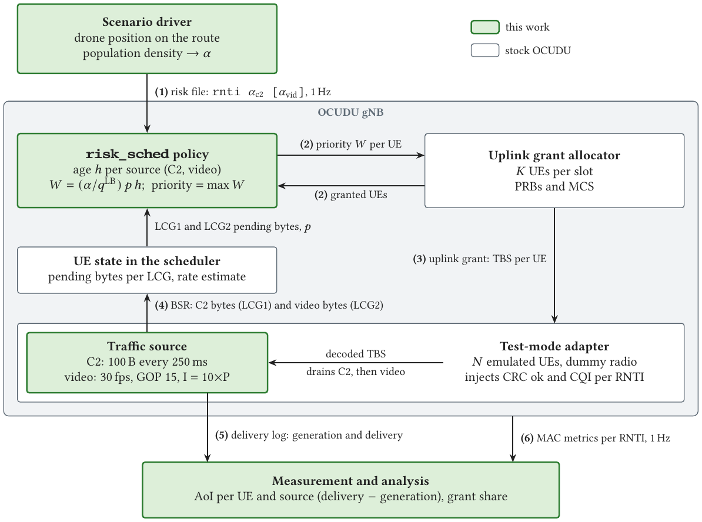

# ocudu-sched: risk-aware scheduling on OCUDU

Implementation of the paper's scheduling policy on **OCUDU** (the Linux Foundation gNB CU/DU, successor of the
srsRAN Project). The gNB prioritises the uplink of each drone by its ground risk and by the age of information of
two sources per drone: command and control (C2) and video.

Status on 13 Nov 2026: the policy and the two queues work with emulated UEs, without a radio. Only functional and
grant-share tests exist; no AoI measurement under load has been run. A real UE together with emulated UEs still
fails, and the B200 radios have not transmitted.

## Architecture



Green is code from this work; white is stock OCUDU. Figure source: `figs/fig_components_interfaces.tex`.

### Components

| Component | Location | Role |
|---|---|---|
| Scenario driver | `exp/alpha_flight.py`, outside the gNB | simulates the drone positions on the route, evaluates the population density and writes the risk coefficient α |
| `risk_sched` policy | `ocudu/lib/scheduler/policy/scheduler_time_risk.{h,cpp}` | computes the uplink priority of each UE from α, the age and the channel |
| Grant allocator | OCUDU (`intra_slice_scheduler.cpp`) | picks the K highest-priority UEs of the slot and sets PRBs and MCS |
| UE state | OCUDU (`logical_channel_system`, rate estimator) | holds the pending bytes per logical channel group (LCG) and the estimated rate |
| Test-mode adapter | OCUDU (`lib/du/du_high/test_mode/`) | creates N emulated UEs and injects CRC ok and CQI in place of the PHY |
| Traffic source | `ocudu/lib/du/du_high/test_mode/test_mode_traffic_source.{h,cpp}` | generates C2 and video per emulated UE, drains the queues on each grant and reports the pending bytes |
| Measurement and analysis | `exp/analyze_twoq.py`, `exp/plot_alpha_flight.py` | AoI per UE and source, grant share |

### Interfaces

| # | Interface | From → to | Content | Rate |
|---|---|---|---|---|
| 1 | Risk file | driver → policy | one line per UE: `rnti_hex α_c2 [α_video]` | written at 1 Hz; reloaded every `alpha_reload_period_ms` |
| 2 | Policy interface | allocator ↔ policy | uplink candidates → priority W per UE; granted UEs → age restart | every uplink slot |
| 3 | Uplink grant | allocator → emulated UE | transport block size (TBS) granted to the UE | every grant |
| 4 | BSR | traffic source → UE state | pending bytes of C2 (LCG1) and of video (LCG2) | on each generation and after each decoded grant |
| 5 | Delivery log | traffic source → analysis | CSV `t_us,rnti,source,event,seq,bytes,gen_us` | on each delivery or drop |
| 6 | MAC metrics | gNB → analysis | bit rate and grants per RNTI on stdout | 1 Hz |

Interface 2 is the OCUDU `scheduler_policy` interface (`compute_ue_ul_priorities`, `save_ul_newtx_grants`),
unchanged. The gNB receives neither position nor density: it receives only α, already computed by the driver.

## How it works

### Risk

The driver computes everything outside the gNB (`exp/alpha_flight.py`):

- **Position:** kinematics of route B of the RC14 scenario (Interlagos), a straight 4264 m leg, constant speed,
  drones in a line with a fixed headway.
- **Density:** synthetic map of the event, 24 Gaussian hotspots (σ = 180 m), evaluated at the drone position and
  normalised (ρ_norm).
- **Coefficient:** α = 1 + 7·ρ_norm; α = 1 before take-off and after landing.

The driver writes only the C2 α. The video α uses `default_alpha_video` until we define how it varies.

### Traffic: two queues per UE

Enabled by `test_mode.test_ue.c2_video_traffic: true`. Without it, the emulated UE has a full buffer on SRB1 (LCG0).

| | C2 | Video (AVIATOR model) |
|---|---|---|
| Generation | one sample every 250 ms | 30 frames/s in groups of 15: 1 I-frame + 14 P-frames |
| Size | 100 bytes | I-frame = 10× P-frame (functional test: 30 000 and 3 000 bytes) |
| Channel group | LCG1 (GBR DRB) | LCG2 (non-GBR DRB) |
| Buffer | a new sample replaces the one that did not leave | one frame in service and one pending; a new frame overwrites the pending one |

- **Service:** each decoded PUSCH drains C2 first and video after it, as the logical channel prioritisation of a
  real UE does. Each grant loses 8 bytes to headers.
- **Logical channels:** the two channels exist only in the scheduler configuration. The emulated UE reports BSRs and
  never sends data, so there is no RLC or PDCP.
- **Phases:** the generation instants and the I-frames are spread across the UEs.

### Policy

    W = V · p · h      V = α / q_LB      q_LB = min(K·√(α·p) / Θ, p)      Θ = Σ √(α / p)

- **Sources:** each UE has up to two (C2 and video). The sum Θ runs over the sources with data of the slot's
  candidates.
- **UE priority:** the highest W among its sources with data.
- **Age h:** slots since a grant emptied the queue of that source. A grant that covers all the pending bytes
  restarts both ages; a grant that covers only the C2 bytes restarts the C2 age.
- **Channel p:** `success_prob` if the estimated TBS is at least `min_tbs_bytes`; otherwise the UE gets the lowest
  priority.
- **Single source:** a UE without data in LCG1 and LCG2 (stock full buffer) counts as one source whose age restarts
  on every grant.
- **Downlink:** delegated to the stock QoS/PF policy.

### AoI

The policy estimates the age from the emptying of the queue and does not know the generation instant. The reference
AoI is measured outside the scheduler: delivery minus generation, from the traffic source log (interface 5).

## How to run

### Build

```bash
docker build -t ocudu-dev:24.04 docker-dev
git clone --depth 1 -b dev https://gitlab.com/ocudu/ocudu.git ocudu     # patch base: v26.10.0, d25a696
git -C ocudu apply ../patches/ocudu-sched-all.patch
./dev.sh cmake -S /work/ocudu -B /build -G Ninja -DCMAKE_BUILD_TYPE=Release -DENABLE_EXPORT=ON \
  -DENABLE_ZEROMQ=ON -DENABLE_UHD=ON -DENABLE_DPDK=OFF -DBUILD_TESTING=OFF -DENABLE_WERROR=OFF \
  -DCMAKE_C_COMPILER_LAUNCHER=ccache -DCMAKE_CXX_COMPILER_LAUNCHER=ccache
./dev.sh ninja -C /build gnb
```

The `ocudu/` clone is not versioned here; the patch carries all our changes. The build lives in the docker volumes
`ocudu-build` and `ocudu-ccache`. Nothing needs sudo on the host.

### Runs

| Goal | Command |
|---|---|
| Two queues, stock policy | `exp/run_twoq.sh <tag> <dur_s>` |
| Two queues, `risk_sched` | `exp/run_twoq.sh <tag> <dur_s> -c /work/configs/policy_risk_twoq.yml` |
| AoI of a run | `exp/analyze_twoq.py logs/twoq/<tag>.csv` |
| Single source, grant share | `exp/run_testmode.sh <tag> <dur_s> -c /work/configs/k1_per_slot.yml -c /work/configs/policy_risk.yml` |
| Flight with α(t) | `exp/alpha_flight.py --tag <tag> --policy risk\|pf` and `exp/plot_alpha_flight.py` |

`run_twoq.sh` reads the source parameters from the environment: `NOF_UES`, `C2_PERIOD_MS`, `C2_BYTES`, `VIDEO_FPS`,
`VIDEO_GOP`, `VIDEO_I_BYTES`, `VIDEO_P_BYTES`.

### Configuration

`cell_cfg.scheduler.policy.risk_sched`:

| Key | Default | Meaning |
|---|---|---|
| `ues_per_slot` | 1 | K used in the q_LB computation |
| `success_prob` | 0.9 | nominal success probability p |
| `default_alpha` | 1.0 | C2 α of a UE absent from the file |
| `default_alpha_video` | 1.0 | video α when the line has no third column |
| `min_tbs_bytes` | 1 | channel gate threshold |
| `alpha_file` | `/tmp/ocudu_risk_alpha.txt` | risk file (interface 1) |
| `alpha_reload_period_ms` | 1000 | reload period |

`test_mode.test_ue`: `c2_video_traffic` (false), `c2_period_ms` (250), `c2_bytes` (100), `video_fps` (30),
`video_gop` (15), `video_i_bytes` (30000), `video_p_bytes` (3000), `traffic_log` (empty = no log).

**Contention:** with few UEs OCUDU serves all of them in every TDD cycle and the priority only reorders PRBs. To make
UEs contend for grants, as in the simulator, use `configs/k1_per_slot.yml` (`pusch.max_puschs_per_slot: 1`) or more
than ~24 UEs.

## Results

Cell n78, 20 MHz, 30 kHz, no radio, 8 emulated UEs, one uplink grant per slot. Uplink capacity ≈ 21 Mb/s.

**Grant share, single source** (α = 1,1,1,1,4,4,16,16):

| α | predicted (∝ √α) | `risk_sched` | PF |
|---|---|---|---|
| 1 | 0.0625 | 0.068 | 0.125 |
| 4 | 0.125 | 0.121 | 0.125 |
| 16 | 0.250 | 0.242 | 0.125 |

**Flight with α(t)** (4 drones on route B, 4 on corridor A, 45 m/s, 141 s; `logs/flight/`):

| grant share of corridor B | `risk_sched` | predicted | PF |
|---|---|---|---|
| flight average | 0.601 | 0.627 | 0.500 |
| peak | 0.667 | 0.736 | 0.501 |

Error per UE: mean 0.009, p95 0.024. The measured share saturates at exactly 2/3 at the peak; cause not verified.

**Two queues, functional test** (20 s, 1.15 Mb/s per UE, ~43% of the capacity):

| | PF | `risk_sched`, uniform α |
|---|---|---|
| Mean C2 AoI | ~131 ms | ~132 ms |
| Mean video AoI | ~25 ms | ~25 ms |
| Dropped frames | 0 | 0 |

At this load all the queues empty, so the test validates the mechanism and does not separate the policies.

## Limitations and open items

- **Age in the policy:** restarts on the grant that empties the queue, not on the delivery confirmation, and does
  not know the generation instant.
- **Scheduling request:** the BSR is injected directly on generation, without the SR latency of a real UE.
- **C2 rides along:** the grant belongs to the UE, so any video grant carries the C2 sample too.
- **Channel:** all emulated UEs have the same CQI and CRC is always ok; the channel gate is not exercised.
- **Video α:** fixed, not provided by the driver.
- **Measurement under load:** high-load runs are pending; the parameters await review.
- **Saturation at 2/3:** not investigated.

## Other environments

| Environment | Status | How |
|---|---|---|
| Smoke test without radio and core | passed | `./dev.sh /build/apps/gnb/gnb -c /work/configs/smoke_testmode.yml` |
| End to end over ZeroMQ (Open5GS + gNB + srsUE, FDD n3) | passed, with the stock policy | `docker compose -f compose.zmq.yml up -d` |
| Real UE together with emulated UEs | does not work | the patch forwards the PRACH, but the access stops at Msg4 |
| B200 radios (`328A2C5` gNB, `328A2C6` UE) | not transmitted | the RF path is undefined: cable with ≥ 30 dB attenuators or low-gain antennas |

ZeroMQ pitfalls: the driver requires gains ≤ 0 on the gNB; srsUE cannot decode a Registration Accept with more than
one TAC, so the core starts with `configs/open5gs-5gc.single-tac.yml`; srsUE supports only 15 kHz, hence the FDD n3
cell.

## Layout

| Path | Content |
|---|---|
| `ocudu/` | shallow clone of `https://gitlab.com/ocudu/ocudu.git`, branch `dev` (v26.10.0, d25a696), patched; not versioned |
| `patches/ocudu-sched-all.patch` | all the OCUDU changes in one cumulative patch |
| `docker-dev/`, `dev.sh` | image `ocudu-dev:24.04` (toolchain, UHD 4.6, ZeroMQ) and a wrapper to run commands in it |
| `docker-ue/`, `compose.zmq.yml` | srsUE and the end-to-end ZeroMQ environment |
| `configs/` | gNB and core YAML files and the policy and contention overlays |
| `exp/` | drivers and analyses |
| `figs/` | diagrams (this one and the paper figure, `fig_ocudu_architecture`) |
| `logs/` | run outputs; only the flight data and figure (`logs/flight/`) are versioned |
